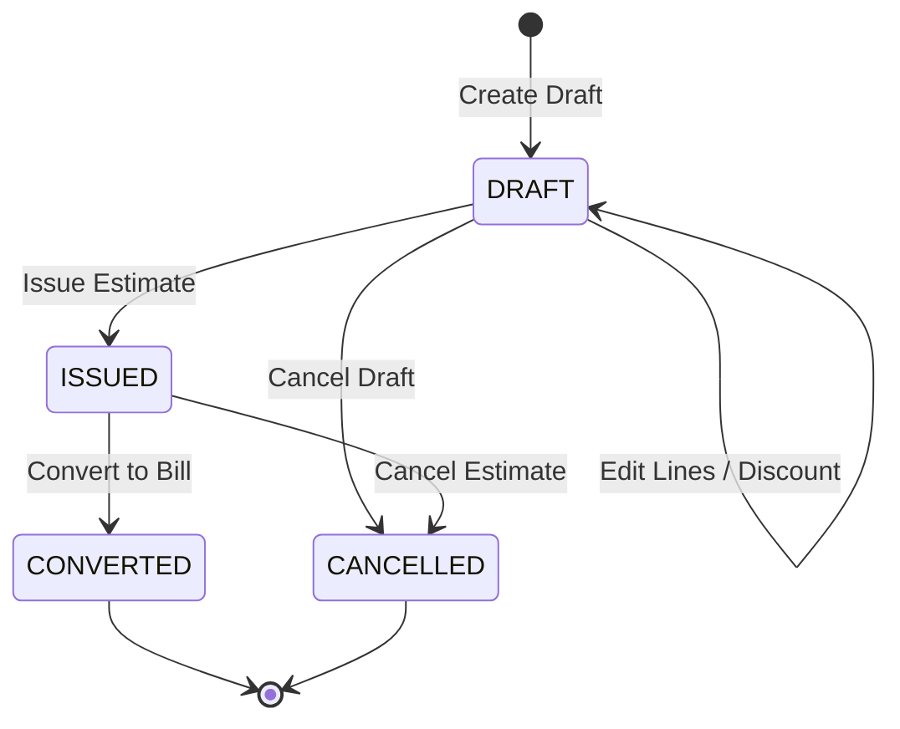
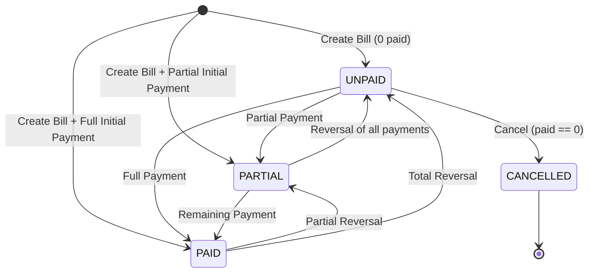

# Billing, Estimates & Payments Guide

## Dr. Susheel's Advanced Dental Clinic & Implant Center

---

## 1. Overview & Clinical Context

In a high-precision dental practice, clinical care and financial transparency go hand-in-hand. Patients undergoing complex restorative, endodontic, or implant procedures need clear cost projections beforehand (Estimates), transparent itemized invoices during or after visits (Bills), and verifiable proof of payments (Receipts).

The PMS provides an append-only, transaction-safe financial engine tailored to Indian dental practice workflows.

### Core Architectural Principles
1. **Integer Paise Precision:** All money values are stored and calculated strictly as integer paise (`₹1 = 100 paise`). Zero floating-point arithmetic is permitted, eliminating rounding discrepancies.
2. **Gapless Fiscal Year Numbering:** Estimates (`EST/YYYY-YY/XXXX`), Bills (`BILL/YYYY-YY/XXXX`), and Receipts (`REC/YYYY-YY/XXXX`) follow Indian financial year numbering (1 April to 31 March) in `Asia/Kolkata` time. Counters are incremented inside MongoDB multi-document transactions; if an operation fails or aborts, counters roll back cleanly with zero gaps.
3. **Immutable & Append-Only:** Financial records are never deleted and never edited in-place once committed with payments. Corrections create auditable reversal records.
4. **Single Source of Financial Truth:** Bill `paid`, `balance`, and `status` (`UNPAID`, `PARTIAL`, `PAID`, `CANCELLED`) are derived and set **exclusively** by the pure reducer function `recomputeBill(total, payments)`. Direct manipulation of bill totals or balances is prohibited.

---

## 2. Estimate Lifecycle



### 1. Building an Estimate
- During or after consultation, the doctor selects treatments from the clinic's seeded price list of 28 standardized dental procedures (IDA aligned).
- **FDI Tooth Notation:** Each procedure can specify zero, one, or multiple FDI two-digit tooth numbers (e.g. `[16]`, `[11, 21]`, `[36, 46]`). Tooth numbers are validated against the international FDI standard (adult quadrants 11-48, deciduous 51-85).
- **Quantity & Pricing:** Quantities range from 1 to 99. The system defaults to the treatment's list price. If the doctor enters a custom unit price (e.g., patient hardship discount or complex anatomy surcharge), the system records `PRICE_OVERRIDE` in the immutable audit log.
- **Discounts:** Supports either a percentage discount (0-100%) or a fixed paise discount. The discount cannot exceed the line subtotal.
- **Validity & Notes:** Doctors specify an optional expiration date (`validUntil`) and clinical treatment notes.

### 2. Issuing the Estimate
- Once finalized, clicking **Issue Estimate** executes an atomic transaction:
  - Allocates the next gapless number in the fiscal year series (`EST/2026-27/0001`).
  - Creates a **frozen snapshot** of clinic letterhead (name, address, phone, registration number), doctor credentials, patient demographics, line items, and totals. Future edits to clinic profile or treatments will never alter issued estimates.
  - Updates status to `ISSUED`.
- **Printing:** Default A5 landscape or optional A4 format with clinic letterhead, date, amount in words, and explicit statutory notice: *"This is a treatment estimate, not a tax invoice or bill."*

---

## 3. Bill Creation & Conversion



### 1. Converting an Estimate to a Bill
- An issued estimate can be converted to an active bill with a single click.
- Conversion is **atomic and idempotent**: inside one transaction, the bill is created with gapless `BILL/YYYY-YY/XXXX`, the estimate status transitions from `ISSUED` to `CONVERTED`, and the estimate stores `convertedToBillId`.
- Expired estimates (`validUntil < today`) or estimates that have already been converted cannot be converted.

### 2. Creating a Bill from a Visit
- Bills can also be created directly for a patient visit without a prior estimate.
- **"One Active Bill Per Visit" Invariant:** A patient visit can have at most one active (non-cancelled) bill. This is enforced at the database level by a unique partial index:
  ```json
  { "clinicId": 1, "visitId": 1, "activeForVisit": 1 }
  where: { "activeForVisit": true }
  ```
  If a bill is cancelled, `activeForVisit` is set to `false`, releasing the lock and allowing a corrected bill to be issued for that visit.

### 3. Atomic Bill + Initial Payment
- When creating a bill (or converting an estimate), the doctor or receptionist can record an initial payment (e.g. advance deposit or immediate cash settlement) in the **exact same transaction**.
- If the payment fails (e.g., amount exceeds total), the entire transaction aborts—leaving no bill and no counter gap.

---

## 4. Payment Collection & Receipts

### 1. Supported Payment Methods
- **CASH:** Direct cash collection at the front desk.
- **UPI:** Digital payment with optional bank/UPI transaction reference (UTR) for reconciliation.

### 2. Overpayment & Concurrency Safeguards
- A payment cannot exceed the bill's outstanding balance (`amount <= balance`).
- **Concurrent Overpayment Race Prevention:** Multi-document transactions run at primary read preference with optimistic version checking (`version === currentVersion` and `$inc: { version: 1 }`). If two front-desk terminals attempt simultaneous payments whose sum exceeds the balance, only the first transaction commits; the second is rolled back and returns a conflict error.
- **Client Idempotency:** Submissions include a UUIDv4 `idempotencyKey`. Network retries or double-clicks safely return the existing payment without duplicate deductions.

### 3. Gapless Receipt Numbering & Frozen Snapshots
- Every payment immediately receives a gapless fiscal year receipt number (`REC/2026-27/0001`).
- The system generates an immutable receipt snapshot containing:
  - Clinic header & registration number
  - Patient demographics & code
  - Bill number & receipt number
  - Payment method & optional UPI reference
  - Payment amount and **Amount in Words (INR)** using paise precision (e.g. *"Rupees Two Thousand Five Hundred and Fifty Paise Only"*)
  - Remaining balance after this payment

### 4. Receipt Printing
- Clean A5 / A4 printable receipt with clinic letterhead, date, amount in words, payment method, balance remaining, and cashier/doctor signature block.
- First print is marked as original; subsequent prints increment `reprintCount` and are audited under `RECEIPT_PRINT`.

---

## 5. Payment Reversals & Corrections

In accounting, financial records are append-only. A mistake is never erased; it is reversed with an opposite entry.

### Reversal Rules
1. **Append-Only Document:** Reversing a payment creates a new document in the `Payment` collection:
   - `isReversal: true`
   - `amount`: negative of original payment (e.g. `-250000`)
   - `reversalOf`: ObjectId of the original payment
   - `receiptNo`: freshly allocated gapless receipt number (`REC/YYYY-YY/XXXX`)
   - `reversalReason`: required text audit reason
2. **At Most Once Reversal:** A payment can be reversed at most once. Enforced at both the domain service layer and the database via a unique partial index:
   ```json
   { "clinicId": 1, "reversalOf": 1 }
   where: { "reversalOf": { "$exists": true } }
   ```
3. **No Reversing a Reversal:** Reversal documents cannot be reversed.
4. **Balance & Status Recalculation:** Calling `recomputeBill` with the reversal entry included increases the bill's balance and automatically moves the bill's status back:
   - `PAID` -> `PARTIAL` (if some payments remain)
   - `PAID` -> `UNPAID` (if all payments reversed)
   - `PARTIAL` -> `UNPAID` (if all payments reversed)
5. **Reversal Receipt:** Can be printed with letterhead, reason for reversal, negative amount, and a prominent `"PAYMENT REVERSED"` watermark.

---

## 6. Bill Editing & Cancellation Rules

### 1. Line Item & Discount Editing
- A bill's line items and discounts can be edited **only while `paid === 0`** (status `UNPAID`).
- Edits use optimistic concurrency locking on `version`.
- As soon as a payment (even partial) is recorded, line items and discounts are **permanently locked**.

### 2. Bill Cancellation
- A bill can be cancelled **only while `paid === 0`**. If payments exist, they must all be reversed first.
- Cancellation requires a non-empty reason.
- Status changes to `CANCELLED`, and `activeForVisit` is set to `false`.
- A cancelled bill is permanent; it cannot receive payments, cannot be edited, and cannot be re-opened.

---

## 7. Daily Closing & Collections Report

- The `collectionsForDay(clinicId, date)` report calculates the clinic's daily cash flow:
  - Total Cash collections (paise)
  - Total UPI collections (paise)
  - Net Total (Cash + UPI, taking reversals into account)
  - Transaction count
- Days are strictly evaluated in `Asia/Kolkata` time from `00:00:00.000` to `23:59:59.999`.
