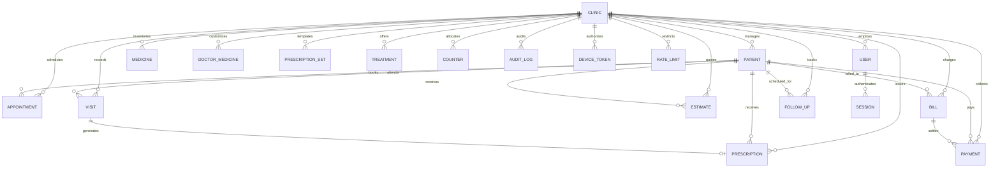

# Data Model Specification

## 1. Entity-Relationship Overview

---

## 2. Collections, Fields & Indexes

Every document contains:
- `clinicId`: ObjectId (required, immutable)
- `schemaVersion`: Number (default 1)
- `createdAt`: Date (immutable)
- `updatedAt`: Date
- `createdBy`: `{ type: 'USER' | 'KIOSK' | 'INTEGRATION' | 'SYSTEM', id: string }`

### `clinics`
- Fields: `name`, `address`, `phone`, `email`, `registrationNo`, `taxId?`, `timezone` (Asia/Kolkata), `paperSize` (A4/A5), `kioskPinHash`, `logoUrl?`, `active`
- Indexes:
  - `{ registrationNo: 1 }` (unique, sparse)

### `users`
- Fields: `clinicId`, `name`, `email`, `phone?`, `passwordHash`, `role` (DOCTOR/STAFF/ADMIN), `totpSecret?`, `totpEnabled`, `recoveryCodes` (hashed), `active`
- Indexes:
  - `{ clinicId: 1, email: 1 }` (unique)

### `sessions`
- Fields: `userId`, `clinicId`, `tokenHash`, `expiresAt`, `lastActiveAt`, `revokedAt?`, `userAgent`, `ip`
- Indexes:
  - `{ tokenHash: 1 }` (unique)
  - `{ expiresAt: 1 }` (TTL)
  - `{ clinicId: 1, userId: 1 }`

### `patients`
- Fields: `clinicId`, `patientCode`, `name`, `phone`, `gender` (M/F/O), `ageYears?`, `dob?`, `address?`, `bloodGroup?`, `allergies`, `medicalConditions`, `notes?`, `consentTextVersion`, `possibleDuplicateOf?`, `deletedAt?`
- Invariants: Exactly one of `ageYears` or `dob` must be present.
- Indexes:
  - `{ clinicId: 1, patientCode: 1 }` (unique)
  - `{ clinicId: 1, phone: 1 }`
  - `{ name: 'text', phone: 'text', patientCode: 'text' }` (text search)

### `appointments`
- Fields: `clinicId`, `patientId`, `doctorId`, `start`, `durationMinutes`, `status` (SCHEDULED/CONFIRMED/COMPLETED/CANCELLED/NO_SHOW), `type` (CONSULTATION/PROCEDURE/FOLLOWUP/EMERGENCY), `notes?`, `source` (MANUAL/KIOSK/ONLINE), `externalId?`, `deletedAt?`
- Indexes:
  - `{ clinicId: 1, start: 1 }`
  - `{ clinicId: 1, source: 1, externalId: 1 }` (unique, sparse)

### `visits`
- Fields: `clinicId`, `patientId`, `date` (YYYY-MM-DD), `token` (integer), `type` (WALK_IN/APPOINTMENT), `status` (WAITING/IN_CONSULTATION/COMPLETED/SKIPPED/NO_SHOW/CANCELLED), `checkInAt`, `startedAt?`, `completedAt?`, `skippedAt?`, `noShowAt?`, `cancelledAt?`, `reasonForVisit`, `caseSheet`, `version`, `createdBy`
- Invariants: Only ONE visit per clinic can be `IN_CONSULTATION` at any time (enforced via partial unique index). Terminal states (`COMPLETED`, `NO_SHOW`, `CANCELLED`) cannot transition.
- Indexes:
  - `{ clinicId: 1, date: 1, token: 1 }` (unique)
  - `{ clinicId: 1, patientId: 1, date: 1 }`
  - `{ clinicId: 1, status: 1 }` (unique, partial: `{ status: 'IN_CONSULTATION' }`)

### `idempotencyKeys`
- Fields: `clinicId`, `key`, `status` (PROCESSING/COMPLETED), `response?`, `createdAt`
- Invariants: Guarantees at-most-once registration execution under high concurrency.
- Indexes:
  - `{ clinicId: 1, key: 1 }` (unique)
  - `{ createdAt: 1 }` (TTL: 86400 seconds / 24 hours)

### `medicines` & `doctorMedicines`
- Fields: `clinicId`, `genericName`, `brandName?`, `form` (TABLET/CAPSULE/SYRUP/GEL/MOUTHWASH/INJECTION/DROPS), `strength`, `route` (ORAL/TOPICAL/SUBLINGUAL/INFILTRATION), `category`, `source` (SAMPLE/DOCTOR/SYSTEM), `verified` (boolean), `active` (boolean)
- Indexes:
  - `{ clinicId: 1, active: 1 }`
  - `{ genericName: 'text', brandName: 'text' }` (text search)

### `prescriptionSets`
- Fields: `clinicId`, `name`, `diagnosis?`, `items`: `[ { medicineId?, genericName, brandName?, form, strength, dose, frequency, durationDays, instructions } ]`, `deletedAt?`
- Indexes:
  - `{ clinicId: 1, name: 1 }`

### `prescriptions`
- Fields: `clinicId`, `patientId`, `doctorId`, `visitId?`, `rxNumber`, `items`, `notes?`, `validUntil`
- Invariants: Never soft-deleted or modified after creation.
- Indexes:
  - `{ clinicId: 1, rxNumber: 1 }` (unique)
  - `{ clinicId: 1, patientId: 1, createdAt: -1 }`

### `treatments`
- Fields: `clinicId`, `code`, `name`, `category`, `idaMin` (Paise), `idaMax` (Paise), `unit`, `active`
- Indexes:
  - `{ clinicId: 1, code: 1 }` (unique)
  - `{ clinicId: 1, category: 1 }`

### `estimates`
- Fields: `clinicId`, `patientId`, `visitId?`, `estimateNo?`, `items`: `[ { treatmentId?, description, teeth: number[], qty, listPrice, unitPrice, amount } ]`, `subtotal`, `discount`, `total`, `validUntil?`, `notes?`, `status` (`DRAFT`/`ISSUED`/`CONVERTED`/`CANCELLED`), `convertedToBillId?`, `replacesEstimateId?`, `cancelReason?`, `snapshot?` (frozen letterhead, patient, doctor, items, totals), `printCount`, `version`, `issuedAt?`, `createdBy`
- Invariants:
  - Numbers in series: `EST/YYYY-YY/XXXX` allocated atomically inside transaction upon transition to `ISSUED`.
  - Money stored exclusively in integer `Paise`. Zero floating-point arithmetic.
  - Frozen snapshot created upon `ISSUED`; future price changes or patient edits do not alter the snapshot.
- Indexes:
  - `{ clinicId: 1, estimateNo: 1 }` (unique, sparse)
  - `{ clinicId: 1, patientId: 1, createdAt: -1 }`
  - `{ clinicId: 1, status: 1 }`

### `bills`
- Fields: `clinicId`, `patientId`, `visitId?`, `estimateId?`, `billNo`, `items`: `[ { treatmentId?, description, teeth: number[], qty, listPrice, unitPrice, amount } ]`, `subtotal`, `discount`, `total`, `paid`, `balance`, `status` (`UNPAID`/`PARTIAL`/`PAID`/`CANCELLED`), `activeForVisit` (boolean), `cancelReason?`, `printCount`, `version`, `createdBy`
- Invariants:
  - Numbers in series: `BILL/YYYY-YY/XXXX` allocated atomically inside transaction upon bill creation.
  - `paid`, `balance`, and `status` are derived and set ONLY by pure reducer `recomputeBill(total, payments)`.
  - One active bill per visit enforced via partial unique index `{ activeForVisit: true }`.
  - Editing lines and discounts locked once `paid > 0` or if cancelled.
  - Cancellation allowed only when `paid === 0` and requires a non-empty audit reason.
- Indexes:
  - `{ clinicId: 1, billNo: 1 }` (unique)
  - `{ clinicId: 1, visitId: 1, activeForVisit: 1 }` (unique, partialFilterExpression: `{ activeForVisit: true }`)
  - `{ clinicId: 1, patientId: 1, createdAt: -1 }`
  - `{ clinicId: 1, status: 1 }`

### `payments` (APPEND-ONLY)
- Fields: `clinicId`, `billId`, `receiptNo`, `amount` (Paise; negative for reversals), `method` (`CASH`/`UPI`), `upiRef?`, `isReversal` (boolean), `reversalOf?` (ObjectId of original payment), `idempotencyKey?`, `snapshot` (frozen letterhead, patient, billNo, receiptNo, date, method, amount, amountInWords, balanceAfterPayment), `printCount`, `receivedAt`, `createdBy`
- Invariants:
  - Strict append-only. Zero updates or deletions permitted (guarded at model schema level).
  - Numbers in series: `REC/YYYY-YY/XXXX` allocated atomically inside transaction for both payments and reversals.
  - Reversals create new documents referencing `reversalOf` with required reason; original payment is never modified or deleted.
  - A payment can be reversed at most once (enforced at code level and database unique partial index).
  - Reversals cannot be reversed.
  - Client idempotency key prevents duplicate charges.
- Indexes:
  - `{ clinicId: 1, receiptNo: 1 }` (unique)
  - `{ clinicId: 1, billId: 1, createdAt: 1 }`
  - `{ clinicId: 1, idempotencyKey: 1 }` (unique, sparse)
  - `{ clinicId: 1, reversalOf: 1 }` (unique, partialFilterExpression: `{ reversalOf: { $exists: true } }`)
  - `{ clinicId: 1, receivedAt: 1 }`

### `followUps`
- Fields: `clinicId`, `patientId`, `doctorId`, `dueDate`, `reason`, `status` (SCHEDULED/COMPLETED/CANCELLED/RESCHEDULED), `notes?`, `deletedAt?`
- Indexes:
  - `{ clinicId: 1, dueDate: 1, status: 1 }`

### `counters`
- Fields: `_id` (`${clinicId}:${key}`), `sequence` (integer), `updatedAt`
- Indexes:
  - `{ _id: 1 }` (primary)

### `auditLogs` (APPEND-ONLY)
- Fields: `clinicId`, `action`, `entity`, `entityId`, `actor`: `{ type, id }`, `meta` (IDs and changed field names only; no values), `ip`, `userAgent`, `at`
- Indexes:
  - `{ clinicId: 1, at: -1 }`
  - `{ clinicId: 1, entity: 1, entityId: 1, at: -1 }`

### `deviceTokens`
- Fields: `clinicId`, `tokenHash` (SHA-256), `name`, `role` (KIOSK), `expiresAt`, `lastUsedAt`, `revokedAt?`, `userAgent`, `ipPrefix`
- Indexes:
  - `{ tokenHash: 1 }` (unique)
  - `{ expiresAt: 1 }` (TTL)

### `rateLimits`
- Fields: `key`, `windowStart`, `count`, `expireAt`
- Indexes:
  - `{ key: 1 }` (unique)
  - `{ expireAt: 1 }` (TTL)

---

## 3. Counter Keys & Numbering Formats

| Key Pattern | Format | Scope | Allocation Strategy |
| :--- | :--- | :--- | :--- |
| `patientCode` | `P-000001` | Lifetime | Gappable, allocated outside transaction |
| `token:YYYY-MM-DD` | `1`, `2`, `3`... | Daily | Gappable, resets each clinic day |
| `rx:FY` | `RX/2026-27/0001` | Financial Year | Gapless, inside MongoDB transaction |
| `bill:FY` | `BILL/2026-27/0001` | Financial Year | Gapless, inside MongoDB transaction |
| `receipt:FY` | `REC/2026-27/0001` | Financial Year | Gapless, inside MongoDB transaction |
| `estimate:FY` | `EST/2026-27/0001` | Financial Year | Gapless, inside MongoDB transaction |

*Financial Year definition:* 1 April to 31 March evaluated in `Asia/Kolkata` time.

---

## 4. Immutability & Soft-Delete Rules

1. **Soft Delete (`deletedAt`):**
   - Only permitted on `patients`, `appointments`, `followUps`, and `prescriptionSets`.
   - Hidden from standard views but preserved for historical traceability.

2. **Immutable / Append-Only Collections:**
   - `Payment`: Reversals and corrections are represented as a new `REVERSAL` record referencing `originalPaymentId`.
   - `AuditLog`: Pure chronological event log.
   - Enforced by Mongoose append-only plugin blocking all update, replace, and delete operations.

3. **Financial Records:**
   - `bills`, `prescriptions`, `estimates`, and `visits` cannot be deleted; they use workflow status flags (`CANCELLED`, `EXPIRED`, etc.).
   - `bills.paid` and `bills.balance` can only be calculated and updated via `recomputeBill(bill, payments)`.
